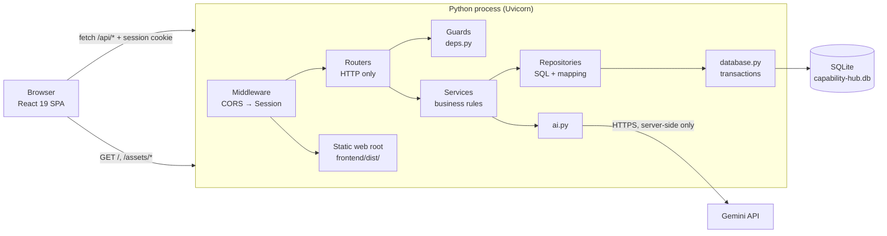
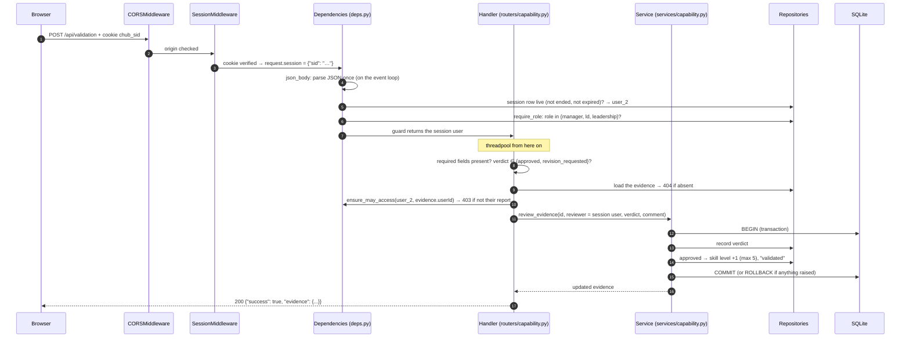
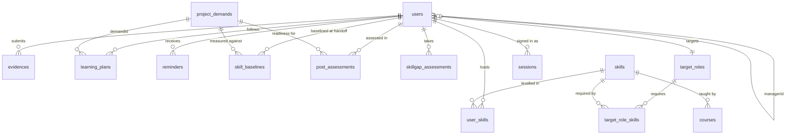
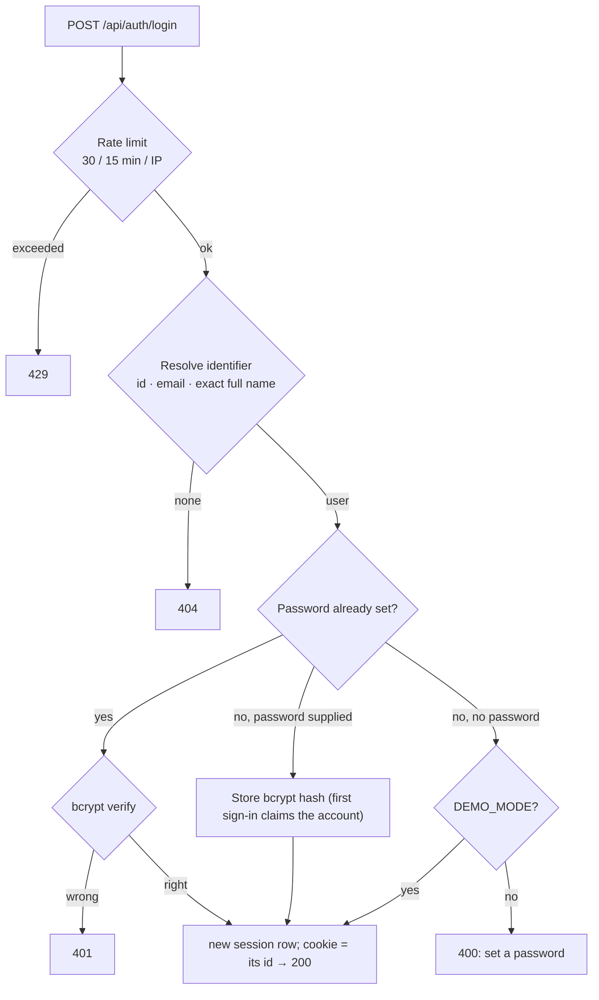
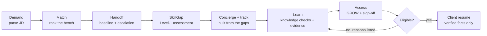

# CyBridge — Architecture

How the system is put together, and in particular how the Python backend handles a
request from the moment it arrives to the moment it answers. Everything here
describes the code as it is; where the code has a known weakness, the
[Known limitations](#15-known-limitations) section says so rather than this document
glossing over it.

---

## 1. System at a glance

CyBridge matches people to client project demand using evidence of what they can
actually do, then closes the gap with targeted learning. It runs as **one process**:
a Python/FastAPI server that answers the JSON API under `/api` and serves the built
React app for every other path, on a single origin.



Three properties follow from that shape and are relied on throughout:

1. **The browser never holds a credential and never reaches the database or Gemini.**
   The Gemini key and the SQLite file live inside the process; the client only ever
   sees the JSON a route chose to return.
2. **Identity comes from the session cookie and nothing else.** A user id in a URL
   or request body names the *target* of an action, never the caller.
3. **No number on screen is invented.** Every metric is computed from stored records,
   or shown as not measured, or omitted. The landing page's product illustrations are
   labelled "Example" and use no real person's data.

---

## 2. Repository layout

| Path | What it is | Status |
|---|---|---|
| `frontend/src/` | React 19 + TypeScript single-page app | Live |
| `frontend/public/`, `frontend/index.html` | Static files and the page shell, copied into the build | Live |
| `frontend/assets/` | Source artwork for the brand images; not part of the build | Reference |
| `backend/app/` | Python/FastAPI backend — **the** backend | Live |
| `backend/seed/seed.json` | Seed data loaded into empty tables on first boot | Live |
| `backend/seed/demo_seed.json` | A larger, made-up company for demos, built from `backend/seed/source/` by `backend/scripts/build_demo_seed.py` | Live |
| `backend/seed/demo_journeys.json` | 41 demo people part-way from a client demand to a resume, built by `backend/scripts/build_demo_journeys.py` | Live |
| `backend/seed/skill_aliases.json` | Other names a job description may use for a skill; built by the same script | Live |
| `backend/seed/question_bank.json` | Three multiple-choice questions per catalogue skill, for assessments and knowledge checks | Live |
| `sample-data/job-descriptions/` | One job description per demo role, to paste or upload; built by the same script | Reference |
| `backend/tests/` | In-process test suite (pytest) | Live |
| `backend/scripts/` | Verification probes run against a live server | Live |
| `frontend/dist/` | Built frontend — the **public web root** | Build output |
| `private/` | Files served only through gated endpoints, never statically | Live |
| `scripts/dev-python.cmd`, `setup.sh` | Windows dev launcher for the backend; one-time local setup | Tooling |
| `frontend/vite.config.ts`, `frontend/package.json` | Frontend build, and the dev server that proxies `/api` to the backend | Tooling |
| `Dockerfile`, `DEPLOY.md` | Container image and deployment guide | Deployment |
| `docs/DEMO_SCRIPT.md` | The presenter's script, printed version of the one in the Demo panel | Docs |
| `AGENTS.md` | Rules for AI coding agents working in this repo | Docs |

There is one backend. A Node/Express server that once lived alongside it was
removed on 2026-10-21; `AGENTS.md` records the decision. Node now only builds the
frontend.

---

## 3. Backend layers

The backend is split into layers with a single direction of dependency. Each layer
may call the one below it and never the one above.

```
backend/app/
├── main.py            assembly: middleware, error handlers, routers, static serving
├── routers/           HTTP layer — one module per area
│   ├── auth.py          sign-in, session, password
│   ├── core.py          directory, catalogue, team, workforce metrics, source archive
│   ├── capability.py    capability score, evidence, learning plans, reminders
│   ├── demand.py        project demands, matching, handoff, client resume
│   └── agents.py        AI copilots, SkillGap assessments, post-training assessment
├── deps.py            request dependencies: JSON body + authorization guards
├── services/          business rules — no HTTP, no SQL
│   ├── capability.py    Skill/Will/CRS scoring, team roll-up, evidence workflow
│   ├── matching.py      which skill a name means, whether a person meets it, its courses
│   ├── talent.py        matching engine, handoff, shortlist, resume eligibility
│   ├── questions.py     the question bank
│   ├── skillgap.py      Level-1 assessments: built, answered, scored and stored
│   ├── journey.py       one person's project, assessment, gaps and plan, for every agent
│   ├── learning.py      tracks built from gaps, knowledge checks, deadlines, tracker
│   ├── copilot.py       the four AI personas and their deterministic fallbacks
│   └── analytics.py     organisation-wide metrics and the deployment pipeline
├── repositories/      data access — SQL and row mapping only, one per aggregate
│   ├── users.py  catalog.py  user_skills.py  evidence.py  learning.py
│   ├── demands.py  reminders.py  assessments.py  skillgap.py  sessions.py
│   └── _common.py       clock, id generation, JSON-shape helpers
├── database.py        connections, transactions, startup (migrate, then seed)
├── seed_data.py       the rows a database starts with, and loading the demo data
├── migrations.py      versioned schema migrations
├── schema_sql.py      the frozen version-1 baseline: DDL for all 12 tables
├── errors.py          domain errors (NotFound, Invalid)
├── ai.py              Gemini client wrapper
├── security.py        bcrypt hashing
├── ratelimit.py       sign-in throttling
├── config.py          every environment variable, read once at import
└── numeric.py         js_round — half-up rounding
```

What each layer is allowed to do:

| Layer | Owns | Must not |
|---|---|---|
| **Routers** | Choosing the guard, validating input presence/shape, calling one service, choosing the status code | Run SQL, compute a score, call Gemini |
| **Guards** (`deps.py`) | Deciding whether the signed-in user may act on the request's target | Contain business rules |
| **Services** | Business rules, formulas, AI prompts, and the transaction boundary for any write that touches more than one row | Know about requests, sessions or status codes — they raise `DomainError` instead |
| **Repositories** | One SQL statement per function, and mapping rows to the JSON shape the client expects | Make decisions, or call each other |
| **database.py** | Opening connections, transactions, building the schema | Know what any table means |

The rule that keeps this honest is the transaction boundary: a repository function
writes one thing; a service decides which writes belong together and wraps them in
`transaction()` so they commit or roll back as one.

---

## 4. The life of a request

Here is what happens to `POST /api/validation` — a manager approving an employee's
evidence — from arrival to response. Every other route follows the same path.



Step by step:

1. **CORS** is the outermost layer. Starlette wraps middleware in reverse order of
   registration, so `CORSMiddleware`, registered last, runs first. It only matters
   for a frontend served from a different origin in development; in production the
   app and API share one origin.
2. **Session.** `SessionMiddleware` reads the `chub_sid` cookie, verifies its
   signature against `SESSION_SECRET`, and exposes the payload as `request.session`.
   The only thing stored in it is `sid`, a random session id.
3. **Body.** `deps.json_body` parses the JSON body once and caches it on the request.
   An empty, malformed, or non-object body becomes `{}`, which the handler's field
   checks then reject with the same 400 as a missing field.
4. **Guard.** The route's guard looks the session id up in the `sessions` table,
   loads its user, and checks role or ownership (section 7). A missing, ended or
   expired session is 401; insufficient rights are 403.
5. **Handler.** Runs in FastAPI's threadpool (section 5). It validates what the
   guard cannot know about, such as a verdict value or a record's owner, then calls
   exactly one service.
6. **Service and transaction.** The service opens `transaction()`, calls
   repositories, and the whole unit commits at the end, or rolls back if anything
   raised.
7. **Response.** Whatever the handler returns is serialised to JSON. Errors from any
   layer leave as `{"error": message}` (section 10).

---

## 5. Concurrency model

**Every route handler is a plain `def`, never `async def`.** That choice is
load-bearing.

SQLite access and Gemini calls are blocking. FastAPI runs an `async def` handler
directly on the event loop, so a blocking call inside one freezes the entire server
for as long as the call takes. A 40-second Gemini response would stall every other
user, the health check included. A plain `def` handler runs on a worker thread from
FastAPI's threadpool instead, and the event loop keeps serving everyone else.

The one `async` dependency is `json_body`, because reading the request body is
itself asynchronous. It runs on the loop, finishes quickly, and hands the parsed
dict to synchronous code.

`backend/tests/test_concurrency.py` pins this down: it simulates a 1.5-second AI
call and requires a health check sent during it to return promptly. With the
handler changed back to `async def`, the test fails.

---

## 6. Data layer

### Transactions (`database.py`)

All database access goes through one context manager:

```python
with transaction() as conn:   # one connection, committed once at the end
    ...
```

- **Atomic.** It commits when the block exits normally and rolls back if anything
  inside raises.
- **Re-entrant.** The open connection is kept in a thread-local. A repository
  function called inside a service's `transaction()` block joins it rather than
  opening its own, so a service can compose several repository calls into one unit.
- **Thread-safe by construction.** One request runs on one worker thread, so its
  transaction can never leak into another request.
- **Connection settings.** WAL journal mode, foreign keys enforced, and a 10-second
  busy timeout so that concurrent writers wait for each other instead of failing.

Writes that must be atomic, and are:

| Operation | Rows written together |
|---|---|
| Submit evidence | evidence row + skill status → `practicing` |
| Review evidence | verdict + skill level/status |
| Change target role | user's role + one skill row per requirement |
| Assign a learning track | delete old plan + insert every new step |
| Handoff to SkillGap | skill baselines + escalation reminder |

### Schema and migrations

The backend owns its schema, and changes to it are **versioned migrations**
(`migrations.py`). The version is SQLite's built-in `PRAGMA user_version`. At startup,
`database.init_database()` applies every migration newer than the database, then
seeds empty tables. It runs from the application's lifespan hook, and lazily from the
first `transaction()` for code that runs without the app, such as tests and scripts.

How a migration runs:

- **All or nothing.** Each migration runs in its own `BEGIN IMMEDIATE` transaction
  that also records the new version, so a database can never claim a version whose
  changes it lacks. A migration that fails part-way leaves the database exactly as
  it was.
- **Safe under concurrent starts.** The version is re-read once the write lock is
  held, so two processes starting together cannot both apply the same migration.
- **Referentially safe.** A migration that would *introduce* a foreign-key violation
  is rolled back. Violations already present in the data do not block startup.
- **Never run backwards.** A database newer than the code (migrated by a later
  release, then rolled back) is refused at startup, with the reason, instead of being
  read with the wrong schema.

**Migration 1 is the baseline.** It brings any database to the schema in
`schema_sql.py`: it creates missing tables, then adds every missing column with the
type and default the baseline declares. That one rule covers every historical
shape: an empty file, a database this backend built, and a database built by any
version of the Node server, which added 20 columns over time with `ALTER TABLE`.
Existing rows are kept, and new columns take their defaults.

To change the schema, **append a migration with the next version number**. Never edit
`schema_sql.py`. It is the frozen baseline, and editing it would give new databases
a schema that existing ones never receive, because migration 1 never runs twice. A
test fingerprints the file and fails if it changes.

| Version | Change |
|---|---|
| 1 | Baseline: the 12 tables in `schema_sql.py`, and any column an older database lacks |
| 2 | `sessions` table, for sessions the server can end (section 7) |
| 3 | `rate_limits` table, so sign-in throttling is shared by every worker (section 7) |
| 4 | `eri_snapshots` table, one Enterprise Readiness Index reading per day (section 8) |
| 5 | Data: corrects one seeded job title ("Senior Senior Software Engineer"), only where it is still that exact value |
| 6 | `skillgap_assessments` table: Level-1 assessments and the scores the server gave them (section 8) |

### Seed data

`seed/seed.json` holds 306 rows: the base people, skills and demands. `seed/demo_seed.json`
adds a made-up company for demos: 381 employees and 35 managers in 11 practices, 166
technologies, 75 job roles and 34 client demands with full job descriptions. Every opening
ranks at least six people who meet two in five of its skills, from close to ready down to
needing training (`tests/test_demo_data.py` checks each demand and job description). Dates in it
are relative to the day it is loaded, so its interviews are ahead. A database that starts
from nothing gets both, unless `SEED_DEMO_DATA=false`; one that already has people gets the
demo rows only from `backend/scripts/load_demo_data.py`, which backs the database up, adds
what is missing and never changes a row that is there.

`seed/demo_journeys.json` takes 41 of those people part-way from a demand to a resume, so
every stage of the pipeline has someone in it. Nothing in it is written by hand: the build
script walks each person through the application's own services (handoff, Level-1
assessment, track, knowledge checks, evidence, sign-off) on a throwaway database with a
moving clock and no model, and keeps the rows those services stored. A new database gets
them with the demo company, unless `SEED_DEMO_JOURNEYS=false`. An existing one gets them
from `load_demo_data.py --journeys`, which replaces the plan and levels only of demo people
nobody has worked with, and dates their projects from the same day.

On startup, each table that is **still empty** is
seeded, under the write lock so concurrent starts cannot both fill it; a table with
rows is never touched. A fresh deployment therefore builds itself, and a running one
keeps its data across restarts. Password hashes are
deliberately absent from the seed: the first sign-in to each account sets its
password.

### The JSON contract

Repositories map rows to exactly the shape the React client was built against.
`_common.py` encodes those conventions:

- **Timestamps** are UTC with millisecond precision and a `Z` suffix:
  `2026-08-27T10:00:00.000Z`.
- **Optional fields** are omitted when empty, not sent as `null` (`compact`).
- **Whole-number REAL columns** are sent as integers: `8`, not `8.0` (`js_number`).
- **Percentages** round half-up via `numeric.js_round`. Python's built-in `round()`
  uses banker's rounding, which turns 62.5 into 62 instead of 63.

### Tables



| Table | Holds |
|---|---|
| `users` | Everyone: employees, managers, L&D, leadership. `managerId` is the reporting line that authorization relies on. `passwordHash` is never mapped into any response. |
| `skills`, `target_roles`, `target_role_skills` | The skills catalogue and what each target role requires (minimum level per skill). |
| `user_skills` | Each person's current and target level per skill, with a status (`not_started` → `learning` → `practicing` → `validated`). |
| `evidences` | Workplace proof a person submits for a skill, and a manager's verdict on it. |
| `learning_plans` | The ordered steps of a learning track, with progress, quiz score and time spent. `demandId` + `purpose = project_hiring` tie a track to a client demand. |
| `courses` | The course catalogue the copilots recommend from. |
| `reminders` | Nudges, check-ins, campaign notices, project-handoff escalations and escalations to L&D, shown in the employee's inbox on My readiness. The types `escalation`, `campaign` and `ld_escalation` are written only by the server; `POST /api/reminders` refuses them, so they cannot be forged. |
| `project_demands` | Open client requisitions: required skills, experience band, interview date. |
| `skill_baselines` | Levels captured at handoff, the "before" that growth is measured against. Covers every skill the demand requires, also ones the person has no record of yet (at the level a new record starts at). A repeat handoff moves `capturedAt`, never the level. |
| `sessions` | Sign-in sessions: who, when it expires, and whether it was ended (section 7). Added by migration 2. |
| `rate_limits` | Sign-in attempts per client address in the current 15-minute window. Added by migration 3. |
| `eri_snapshots` | One Enterprise Readiness Index reading per day, with the share of its weight measured. Added by migration 4. |
| `post_assessments` | Post-training GROW assessments and a manager's sign-off. Each belongs to the demand the person was handed off to. |
| `skillgap_assessments` | Level-1 assessments: the questions with their answer key, the answers, the evaluations and the result. Added by migration 6. |

---

## 7. Authentication and authorization

### Sessions

A session is a **row in the `sessions` table**; the cookie only names it. Signing
in inserts a row with a random 256-bit id (`secrets.token_urlsafe(32)`) and an
expiry 8 hours out. Starlette's `SessionMiddleware` then serialises `{"sid": ...}`,
signs it with `SESSION_SECRET`, and sets it as `chub_sid` (HttpOnly, 8-hour
lifetime).

On every request `deps.get_session_user` accepts the cookie only if its row exists,
has not been ended, and has not expired. Because the server holds that state, it can
end a session, and every copy of the cookie stops working with it:

| Event | Sessions ended |
|---|---|
| Sign out | This one |
| Sign in again from the same browser | The one that browser had |
| Change password | Every other session of that user; the one making the change stays |

A cookie signed in the earlier `{"userId": ...}` format still verifies, but names no
session, so it signs no one in; those users sign in once more. Rows that ended or
expired more than a day ago are deleted at each sign-in. Sessions live in the shared
database, so they survive restarts and work across processes.

The cookie's `SameSite` and `Secure` flags come from configuration:

| Deployment | SameSite | Secure | Why |
|---|---|---|---|
| Plain HTTP (local) | `lax` | no | Browsers reject `Secure` cookies over HTTP |
| HTTPS (default) | `none` | yes | Survives being embedded in a cross-site iframe |
| `COOKIE_SAMESITE=lax` on HTTPS | `lax` | yes | Stricter; right for a standalone deployment |

### Signing in (`routers/auth.py`)



- **The rate limit runs before any credential is examined**, so an attacker is
  refused even on the attempt where they would have guessed right. Its counters
  live in the `rate_limits` table, so every worker shares one count, and each
  attempt is counted in a single write transaction, so concurrent attempts cannot
  slip under the limit. A refusal is a 429 with `Retry-After`.
- **Identifiers match exactly.** A name must match a person's full name; it is not a
  substring search. The first sign-in sets a password, so a loose match could claim
  the wrong person's account.
- **bcrypt, cost factor 10.** Hashes written by the former Node server's
  `bcryptjs` use the same format and still verify.
- **`DEMO_MODE`** accepts a bare user id with no password. It is a full
  authentication bypass and is off unless explicitly enabled.
- `/api/auth/change-password` requires the current password whenever one is set, so
  a hijacked session cannot lock the owner out, and it ends the user's other
  sessions, so changing the password also signs out whoever else holds one.

### The authorization rule

One rule, `deps.may_access(actor, target)`, decides whether a person may act on
another person's data:

> **You may act on yourself. A manager may act on their direct reports. L&D and
> Leadership may act on anyone.**

Every guard and every list endpoint is an application of that rule:

| Guard | Used when the target is… |
|---|---|
| `require_auth` | anyone signed in, with no specific target |
| `require_role(...)` | defined by role, e.g. manager-or-above |
| `require_self_manager_or_elevated("id")` | the user id in the URL path |
| `require_self_or_elevated_body` | the `userId` in the JSON body (absent = yourself) |
| `require_learning_step_owner` | the owner of a learning step, looked up from the database |
| `ensure_may_access(...)` (in handlers) | known only after loading a record, e.g. the owner of a piece of evidence |
| `visible_user_ids(...)` | a list: limits rows to what the single-record rule allows |

The last row matters most for lists. A list endpoint must never show more than the
single-record endpoints would. A manager's evidence queue, reminders and learning
tracker contain only their own team; L&D and Leadership see everyone.

**One deliberate exception: talent sourcing is organisation-wide.** Matching
candidates to a client demand, handing them off for upskilling, checking resume
eligibility and generating a client resume all draw from the whole bench, because
staffing a project is not limited to one manager's team. Coaching and assessment
are not: insights, post-training assessments and their sign-off stay within the
reporting line. A client resume still needs a signed-off assessment, so it cannot be
produced for someone no authorised manager has assessed.

### Route map

Every API route and its guard, read from the running application's dependency
graph:

| Method | Route | Guard |
|---|---|---|
| GET | `/api/health` | public |
| GET | `/api/directory/summary` | public — a profile count only |
| POST | `/api/auth/login`, `/logout` · GET `/api/auth/me` | public (session checked inline) |
| POST | `/api/auth/change-password` | session checked inline |
| GET | `/api/skills`, `/api/roles`, `/api/courses`, `/api/users` | `require_auth` |
| GET | `/api/project-demand/list` | `require_auth` |
| GET | `/api/evidence`, `/api/reminders` | `require_auth` + scoped to `visible_user_ids` |
| POST | `/api/ai/orchestrator` | `require_auth` + `ensure_may_access` on the subject |
| POST | `/api/agent/generate-jd-assessment`, `/assessment-answer`, `/evaluate-interview-answer`, `/complete-skillgap-assessment` | `require_auth`; an assessment is answered only by the person it was made for |
| GET | `/api/users/{id}`, `/capability`, `/learning-plan`, `/shortlist`, `/skillgap-assessment` | `require_self_manager_or_elevated` |
| POST | `/api/users/{id}/target-role` | `require_self_manager_or_elevated` |
| POST | `/api/evidence`, `/api/reminders`, `/api/learning-plan/deadline` | `require_self_or_elevated_body` |
| POST | `/api/learning-plan/step` | `require_learning_step_owner` |
| GET | `/api/learning-plan/step/{stepId}/quiz` | `require_auth` + `ensure_may_access` on the owner |
| POST | `/api/learning-plan/step/{stepId}/quiz` | `require_auth`, the step's owner only |
| GET | `/api/manager/{id}/team` | manager-or-above; a manager only their own id |
| GET | `/api/learning-tracker/resources`, `/api/analytics/workforce`, `/api/analytics/eri`, `/api/analytics/leadership`, `/api/analytics/ld` | manager-or-above (tracker scoped) |
| POST | `/api/analytics/campaign` | L&D or leadership: it reminds employees across the organisation |
| POST | `/api/validation`, `/api/learning-plan/suggest`, `/api/learning-plan/assign` | manager-or-above + `ensure_may_access` |
| POST | `/api/manager/insight`, `/post-assessment`, `/post-assessment/{id}/signoff`, `/escalate` | manager-or-above + `ensure_may_access` |
| POST | `/api/project-demand/create`, `/match`, `/parse-jd`, `/handoff-skillgap`, `/generate-client-resume` | manager-or-above (organisation-wide) |
| GET | `/api/project-demand/{demandId}/resume-eligibility/{employeeId}` | manager-or-above (organisation-wide) |
| GET | `/api/download-app-zip` | Leadership only |
| GET | `/api/demo` · POST `/api/demo/switch` | `demo_tools` (below) + `require_auth`; a switch goes only to the presenter's cast |
| POST | `/api/demo/reset`, `/api/demo/starting-point` | `demo_tools` + manager-or-above, and `confirm: true` |

**The demo tools** (`routers/demo.py`) are for a presenter's own computer. `demo_tools`
answers 404 unless `DEMO_TOOLS=true`, the connection comes from a loopback address, no
forwarding header is present, and the `Host` and `Origin` (when sent) are loopback too, so
neither the network, a proxy, a rebound name nor another site's page can reach them. A
switch needs a live session, replaces it with a new one and ends the old, and goes only to
the people `demo_journeys.json` names; a user id alone still signs nobody in. A reset backs
the database up, then puts back the saved starting point (`backups/demo-starting-point.db`)
or, without one, the sample data as a new database would get it today. It keeps sessions,
sign-in counters, the daily readiness readings and the passwords people have set, and
changes nothing if any reference would break (`snapshot.py`).

---

## 8. Business rules (`services/`)

Every score is a transparent function of stored records, defined in exactly one
place.

| Metric | Formula | Where |
|---|---|---|
| **Skill** (matrix Y axis) | average level ÷ 5 × 100, + 5 per approved evidence, capped at 100 | `capability.skill_score` |
| **Will** (matrix X axis) | 40% learning follow-through + 30% evidence initiative + 20% goal progress + 10% goal commitment | `capability.compute_motivation_scores` |
| **Engagement** | completed plan steps ÷ total steps | same |
| **Capability Readiness Score** | per-skill current ÷ target (capped 100), averaged over the skills that have a target; × 0.85 + up to 15 for approved evidence; not measured when no skill has a target | `capability.capability_report` |
| **Risk** | High at 4+ skills below target, Medium at 2–3 | `capability.team_rollup` |
| **Requirement met** | held at level 3+, or listed as a primary skill, or named by the title or role; names match as whole words | `matching.requirement_status` |
| **Level-1 result** | multiple choice 40% + spoken 60%, or 30 / 40 / 30 with a practical; over the parts taken, unanswered questions in a part count as 0, provisional grades are not counted | `skillgap.finish` |
| **Knowledge check** | right answers ÷ questions asked; a pass completes the step | `learning.submit_quiz` |
| **Project readiness** | share of a demand's required skills met, now against the handoff baseline | `talent.project_readiness` |
| **Match** | 45% technical + 20% domain + 15% experience + 20% capability readiness, capped at 99; below 80 needs upskilling. Technical is the weighted share of required skills met: a general skill (`matching.GENERAL_SKILLS`, such as Git or SQL) counts half unless the opening is named after it | `talent.match_candidates` |
| **Resume eligibility** | project-hiring track complete **and** assessment signed off as cleared **and** at least one skill above its handoff baseline | `talent.resume_eligibility` |
| **Enterprise Readiness Index** | weighted mean of the eight `AGENTS.md` components, over the **measured** ones only (see below) | `analytics.readiness_index` |
| **Readiness by department** (L&D heatmap) | per skill and department: the employees working toward the skill, average of current ÷ target level (capped at 1) | `analytics.ld_overview` |
| **Campaign** | one reminder to every employee below target on the chosen skill, stating their own current and target level | `analytics.launch_campaign` |
| **Escalation to L&D** | a reminder written by the server from the signed-in manager and the employee's stored gap count; listed on the L&D page | `analytics.escalate_to_ld` |
| **Supply against demand** | per skill named by an open demand: ready = employees at level 3+ (the level matching treats as verified), developing = below 3, with a target of 3+ or the skill on their learning plan | `analytics.leadership_overview` |

A demand names skills by text. `matching.find_skill` resolves a name to the catalogue
skill of exactly that name or other name (`seed/skill_aliases.json`: "K8s" is Kubernetes),
ignoring case, and only falls back to containment when there is none, the longest name
inside it first. Containment first would resolve "Java" to "Java Core & OOP Principles".
Containment is by whole words, so Java does not satisfy JavaScript, and two catalogue
skills are never taken for one another: knowing SQL is not knowing SQL Server. An other
name that is also a word counts only as a whole skill name ("Go") or with its capitals
("SAFe").

**Reading a job description.** A model's wording is turned into catalogue names, so
Pinecone, pgvector and "vector stores" are one requirement. Without a model the text is
read by rules: labelled lines, required and optional sections apart, years, dates, openings
and industry. A listed technology the catalogue lacks stays a requirement. The model gets
40 seconds, because the rules are a good answer and someone is waiting.

**A ranking always has a first place.** The match response therefore lists
`uncoveredSkills`, the requirements nobody meets, and the demand page says so and calls the
first person a closest profile rather than a best fit.

### The Enterprise Readiness Index

| Component | Weight | Computed from |
|---|---|---|
| Skill proficiency | 25% | average Skill score |
| Level-1 video/MCQ assessments | 20% | average of each employee's latest graded SkillGap assessment; not measured until one is |
| Workplace evidence validation | 15% | approved ÷ submitted evidence |
| Certification health | 15% | **not measured**: no certification records are kept |
| Capability readiness (CRI) | 10% | average Capability Readiness Score |
| Deployment availability | 5% | share of employees with Skill and Will both 60+ (Deploy Now) |
| Learning engagement | 5% | average learning-plan completion |
| Manager GROW validation | 5% | cleared ÷ signed-off post-training assessments; not measured until one is signed off |

The index is the weighted mean over the measured components, re-weighted to their
share, and the response reports that share as `coverage`. A component with no data is
excluded, never given an assumed score. Each read of `/api/analytics/eri` records that
day's reading in `eri_snapshots` (one row per day, the latest reading wins), and the
trend line is drawn from those rows only. Nothing is back-filled, so the trend starts
on the first day the index is read.

Skill and Will are independent on purpose. Pending evidence counts toward Will
(initiative) but only *approved* evidence lifts Skill, so a highly capable person can
sit low on Will. That's the case the Skill-vs-Will matrix exists to surface.

The **Demand-to-Deployment** flow ties the services together:



What each agent leaves for the next, and where the next one reads it:

| From | Stored | Read by |
|---|---|---|
| Demand-to-Deployment | `skill_baselines`, an inbox message | `talent.active_shortlist`: the demand, its brief, the skills still missing |
| SkillGap | `skillgap_assessments.result` with its gaps | `journey.gaps_for`: the Concierge, the track builder, the GROW coach; the readiness index |
| Concierge and track | `learning_plans` tied to the demand | the employee's plan, the manager's board, resume eligibility |
| Learning | quiz scores, `evidences` | the manager's review; approval raises a level once |
| GROW coach | `post_assessments` for that demand | resume eligibility; the readiness index |
| All of them | the rows above | `analytics.deployment_pipeline` and the analytics copilot |

`services/journey.py` is the one place that puts a person's project, assessment, gaps
and plan together, so no two agents disagree about what is missing.

**Level-1 assessments are scored on the server.** The answer key never reaches the
browser: each question's right option is returned only once it has been answered, the
first answer counts, and a score in a request is ignored. Without a model the
multiple-choice questions come from the question bank and score as usual, while spoken
answers get a provisional grade that is shown but not counted.

The client resume is gated on persisted proof — a completed track, a signed-off
assessment, measured growth — and never on anything the request asserts. Its prompt
contains only verified facts and instructs the model not to invent any.

---

## 9. AI integration (`ai.py`, `services/copilot.py`)

- **Server-side only.** `GEMINI_API_KEY` is read from the environment and used in
  this process. It never reaches the browser.
- **Optional.** The client is created lazily on first use. With no key, or if a call
  fails, every AI endpoint still answers `200` with deterministic fallback text, so
  the product works without a model.
- **Never raises.** `ai.generate()` returns `None` on any failure and the caller
  substitutes its fallback. Fallbacks are recognisable: structured responses carry
  `"_fallback": true`, and text fallbacks have a fixed form. A fallback about a person
  (manager insight, post-training assessment) is written from that person's records -
  strongest skill, gaps, evidence, learning progress - and starts by saying it was
  computed without the model; it never states a judgement the records don't support.
- **Backup models.** When Google answers that a model is overloaded, out of quota, gone
  or past its deadline (429, 404, 503, 504), or it is too slow, the next model in
  `GEMINI_BACKUP_MODELS` is asked, and the busy one is passed over for as long as Google says, up to an hour, else two
  minutes. Google's free tier allows only 20 requests a day for a model, so a full demo
  needs a paid key. A
  rejected key or a bad request fails the same way everywhere, so it is not passed on.
- **Bounded, never retried.** An answer is limited to `GEMINI_TIMEOUT_SECONDS`
  (default 120) over every model tried, and no model is asked twice, so the worst case
  for a request is that long and no longer. Retries are switched off explicitly: the SDK's retry policy
  retries timeouts, and measured against a 1-second timeout it took 22 seconds. The
  default sits well above normal generation time, because long reports have taken
  over 90 seconds. A timeout is logged as one, so a value cutting off real answers is
  visible and can be raised.
- **OS trust store.** The client verifies Gemini's certificate against the
  operating system's trust store (`truststore`), not the HTTP library's bundled
  list. On a machine whose antivirus or proxy inspects TLS, its root certificate is
  only in the OS store, and every call would otherwise fail certificate checks.
- **Structured output.** `ai.generate_json()` asks the model for JSON, and also strips Markdown fences and, if the
  model wrapped the JSON in prose, recovers the outermost `{...}` or `[...]` before
  parsing.
- **Grounded and authorised.** Copilot prompts include a person's skills and
  evidence, so choosing *whose* data goes into a prompt is an authorization decision:
  the subject defaults to the caller, and naming anyone else needs the same right as
  reading their record. The `analytics` persona is grounded in organisation-wide
  figures (the index, its components, skill-gap risk, supply against demand) only for
  managers, L&D and leadership, the roles allowed to read those figures; anyone else
  gets their own skill picture.
- **The coach sees the team.** A manager's coach question is answered from all their
  direct reports' records, and a report it names is described in full. (It used to be
  grounded in the manager's own, empty, skill record.)
- **Model output is checked before it is used.** Generated questions without a usable
  right answer are dropped, scores are clamped, and a parsed job description keeps only
  fields of the right type. Job descriptions, resumes and answers are passed as
  material, with an instruction to ignore instructions inside them.
- **Personas.** `skill_gap`, `concierge`, `coach` and `analytics` each have a
  system instruction in `copilot.PERSONAS`; an unknown persona falls back to a
  generic orchestrator. Model: `gemini-3.6-flash` by default, through `google-genai` 2.8.

Because a fallback also returns `200`, a healthy status code does not prove the
model was reached. Check for the fallback marker instead.

---

## 10. Errors

Every error leaves the server as `{"error": "message"}`, which is the shape the
React client reads.

| Raised as | By | Becomes |
|---|---|---|
| `HTTPException(status, detail)` | routers, guards | that status, `{"error": detail}` |
| `NotFound(message)` | services | 404, `{"error": message}` |
| `Invalid(message)` | services | 400, `{"error": message}` |
| request validation failure | FastAPI | 400, `{"error": "Invalid request payload."}` |

Services never raise `HTTPException`. Keeping HTTP out of the business layer is what
lets the same service be called from a test, a script or another service.

---

## 11. Static serving and the web root

`frontend/dist/` is the **public web root**. Everything in it is served to any browser, so
nothing private may live there.

- `/assets/*` is served by Starlette's `StaticFiles`.
- Every other non-API path goes to one catch-all route. It resolves the requested
  path, collapsing `..` and symlinks, and serves the file **only if the resolved
  path is still inside `frontend/dist/`**. Anything else, whether an unknown route or a path
  that would escape the web root, gets `index.html` so client-side routing can
  take over.
- The route accepts `HEAD` as well as `GET`, because some platforms probe the root
  with `HEAD`.
- Files that should only reach some users (the Leadership source archive) live in
  `private/` and are served by a gated endpoint, never statically.

`backend/tests/test_static_security.py` sends path-traversal attempts as raw,
un-normalised paths. A normal HTTP client would collapse `..` before sending, so a
vulnerable route could still pass the test. The test also asserts that private
files are not under the web root.

---

## 12. Configuration and deployment

Every setting comes from the environment, read once by `config.py`:

| Variable | Default | Purpose |
|---|---|---|
| `PORT` | `8000` | Listen port; injected by most hosts |
| `SESSION_SECRET` | insecure dev value (warns) | Signs the session cookie — **set it in production** |
| `GEMINI_API_KEY` | unset | Enables real AI; otherwise fallbacks |
| `GEMINI_TIMEOUT_SECONDS` | `120` | Upper bound on one answer, over every model tried; invalid values stop startup |
| `GEMINI_MODEL`, `GEMINI_BACKUP_MODELS` | `gemini-3.6-flash`; `gemini-3.5-flash,gemini-flash-lite-latest,gemini-3.1-flash-lite` | The model, and those tried when it is busy |
| `DEMO_MODE` | `false` | Password-free sign-in. **Keep off** anywhere shared |
| `SEED_DEMO_DATA` | `true` | Whether a database that starts empty also gets the demo company |
| `SEED_DEMO_JOURNEYS` | `true` | Whether the demo company comes with people part-way to a resume |
| `DEMO_TOOLS` | `false` | The presenter's person switch and reset, reachable only from the same computer |
| `DATABASE_PATH` | `capability-hub.db` in repo root | Point at a persistent volume in production |
| `COOKIE_SAMESITE` | `none` on HTTPS, else `lax` | Session cookie SameSite policy |
| `AUTH_RATE_LIMIT_MAX` | `30` | Sign-in attempts per IP per 15 minutes |
| `TRUST_PROXY` | `true` | Read the client IP from `X-Forwarded-For` |
| `DIST_DIR`, `PRIVATE_DIR` | `frontend/dist/`, `private/` | Web root and gated files |
| `NODE_ENV`, `APP_URL` | — | HTTPS signal for cookie flags |

Unsafe defaults in force (no secret, no key, `DEMO_MODE` or `DEMO_TOOLS` on) are reported as
warnings in the startup log. They are never reported through a public endpoint.

**Running it.** In development, `scripts\dev-python.cmd` runs Uvicorn with reload
on `:8000`, serving the API and `frontend/dist/` (run `npm run build` in `frontend/` once). In
production, the `Dockerfile` builds the frontend with Node in one stage and runs
FastAPI alone in the next, so no Node is present at runtime. `/api/health` is the
liveness probe. See `DEPLOY.md` for platform-specific notes.

---

## 13. Verification

| Suite | Runs | Covers |
|---|---|---|
| `pytest backend/tests` | in-process, isolated DB, no network, about 2 min | 268 tests: the demo data, the fitment ladder of every opening and eighteen job descriptions it was not made for; the sample journeys, and the demo tools from where they may and may not be used; each of the five agents alone, with and without a model, and the whole flow from demand to resume and analytics; authorization on every person-specific endpoint and list scoping; path traversal and web-root rules; the archive gate; non-blocking handlers; migrations (fresh, legacy upgrade, idempotence, rollback, foreign keys, newer-than-code, frozen baseline); sessions (ending on sign-out and password change, expiry, old-format cookies); rate limits (window, per address, concurrency, a second process); the readiness index, leadership and L&D analytics, campaigns and escalations; Gemini through the real SDK against a local stand-in (response parsing, the timeout, no retries) |
| `backend/scripts/verify_authz_scenarios.py URL` | against a live server | 65 checks across six scenarios: employee features, manager and leadership features, employee → manager access, manager → another team, user-id manipulation, anonymous access |

Run both before merging a backend change. The pytest harness builds a fresh,
isolated database and a controlled file tree, including a decoy secret file beside
the web root, and points the app at them before it is imported. It never touches the
developer's database. Each regression test for a security fix has been checked
against the code it fixes: it fails there and passes on the fix.

---

## 14. The frontend

The React app lives in `frontend/`, with its own `package.json`, and is built there.
It relies on the backend as follows:

- It calls the API with relative paths (`fetch("/api/...")`), so it works on any
  origin that serves both, with no configuration.
- It holds no authority. Hiding a tab a role cannot use is a convenience; the server
  enforces every restriction regardless of what the UI shows.
- `App.tsx` holds the session user, the active tab and the shared data; screens live
  in `frontend/src/components/`, one per role-specific workspace.
- After sign-in, each role lands on its own workspace. The signed-out landing page
  is not reachable from a signed-in session.
- Every workspace opens with a `PageHeader` (what the page is for, and numbered steps)
  and is built from the primitives in `frontend/src/components/ui/` on the theme tokens in
  `index.css`, so all six themes apply. Navigation lives in `components/navigation.ts`;
  the "How it works" guide explains the whole loop and is reachable signed out.
- Uploaded résumés and job descriptions are read in the browser
  (`utils/fileParser.ts`): text files, DOCX (unzipped with the browser's own
  `DecompressionStream`) and PDF (pdf.js, loaded only when a PDF is chosen). A file
  with no readable text is reported to the user; nothing is filled in.

---

## 15. Known limitations

These are real and are not yet fixed:

1. **Certification health is not measured.** No certification records are kept, so
   15% of the readiness index has no data and the index says so. Level-1 assessments
   count from the first one an employee finishes.
2. **One host.** All shared state (data, sessions and sign-in rate limits) is in
   the SQLite file, so any number of workers or processes on one host share it;
   two processes on one database were checked live to share sessions and rate
   limits. Several *hosts* would need a networked database, because SQLite on a
   network filesystem is not safe. On a host with an ephemeral filesystem, mount a
   volume for `DATABASE_PATH` or the data resets on redeploy.
