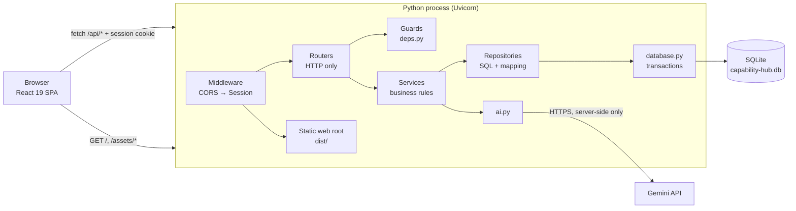
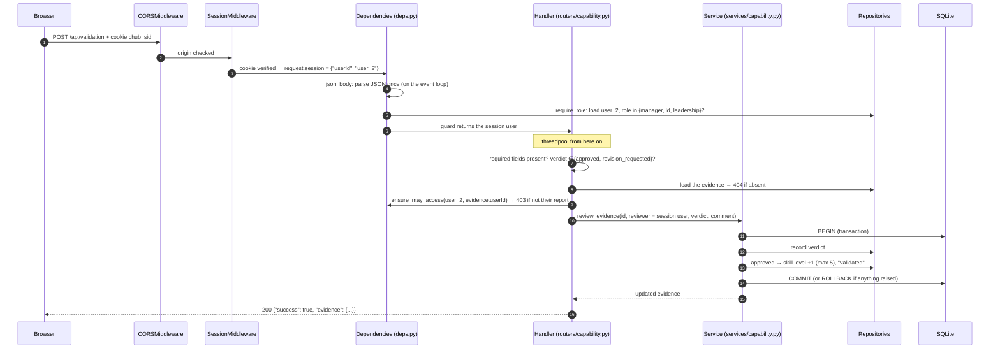
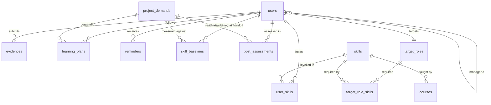
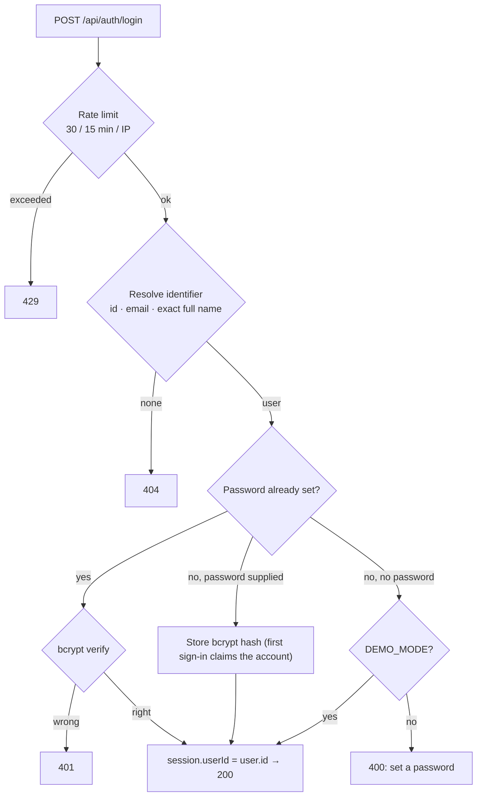
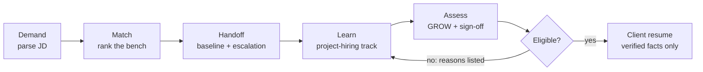

# CyBridge — Architecture

How the system is put together, and in particular how the Python backend handles a
request from the moment it arrives to the moment it answers. Everything here
describes the code as it is; where the code has a known weakness, the
[Known limitations](#15-known-limitations) section says so rather than this document
glossing over it.

---

## 1. System at a glance

CyBridge matches people to client project demand using evidence of what they can
actually do, then closes the gap with targeted learning. It runs as **one process**:
a Python/FastAPI server that answers the JSON API under `/api` and serves the built
React app for every other path, on a single origin.



Three properties follow from that shape and are relied on throughout:

1. **The browser never holds a credential and never reaches the database or Gemini.**
   The Gemini key and the SQLite file live inside the process; the client only ever
   sees the JSON a route chose to return.
2. **Identity comes from the session cookie and nothing else.** A user id in a URL
   or request body names the *target* of an action, never the caller.
3. **No number on screen is invented.** Every metric is computed from stored records,
   or omitted. (One remaining exception is listed under known limitations.)

---

## 2. Repository layout

| Path | What it is | Status |
|---|---|---|
| `src/` | React 19 + TypeScript single-page app | Live |
| `backend/app/` | Python/FastAPI backend — **the** backend | Live |
| `backend/seed/seed.json` | Seed data loaded into empty tables on first boot | Live |
| `backend/tests/` | In-process test suite (pytest) | Live |
| `backend/scripts/` | Verification probes run against a live server | Live |
| `dist/` | Built frontend — the **public web root** | Build output |
| `private/` | Files served only through gated endpoints, never statically | Live |
| `server.ts`, `server-db.ts` | Node/Express backend for the Google AI Studio applet | **Frozen** |
| `scripts/dev-python.cmd` | Windows dev launcher for the backend | Tooling |
| `Dockerfile`, `DEPLOY.md` | Container image and deployment guide | Deployment |
| `AGENTS.md` | Rules for AI coding agents working in this repo | Docs |

The Node backend exists only because Google AI Studio's applet host cannot run
Python. It receives no feature work; see `AGENTS.md` for the decision record.

---

## 3. Backend layers

The backend is split into layers with a single direction of dependency. Each layer
may call the one below it and never the one above.

```
backend/app/
├── main.py            assembly: middleware, error handlers, routers, static serving
├── routers/           HTTP layer — one module per area
│   ├── auth.py          sign-in, session, password
│   ├── core.py          directory, catalogue, team, workforce metrics, source archive
│   ├── capability.py    capability score, evidence, learning plans, reminders
│   ├── demand.py        project demands, matching, handoff, client resume
│   └── agents.py        AI copilots, manager insight, post-training assessment
├── deps.py            request dependencies: JSON body + authorization guards
├── services/          business rules — no HTTP, no SQL
│   ├── capability.py    Skill/Will/CRS scoring, team roll-up, evidence workflow
│   ├── learning.py      plan steps, deadlines, track assignment, tracker roll-up
│   ├── talent.py        matching engine, handoff, shortlist, resume eligibility
│   ├── copilot.py       the four AI personas and their deterministic fallbacks
│   └── analytics.py     organisation-wide metrics
├── repositories/      data access — SQL and row mapping only, one per aggregate
│   ├── users.py  catalog.py  user_skills.py  evidence.py  learning.py
│   ├── demands.py  reminders.py  assessments.py
│   └── _common.py       clock, id generation, JSON-shape helpers
├── database.py        connections, transactions, startup (migrate, then seed)
├── migrations.py      versioned schema migrations
├── schema_sql.py      the frozen version-1 baseline: DDL for all 12 tables
├── errors.py          domain errors (NotFound, Invalid)
├── ai.py              Gemini client wrapper
├── security.py        bcrypt hashing
├── ratelimit.py       sign-in throttling
├── config.py          every environment variable, read once at import
└── numeric.py         js_round — half-up rounding
```

What each layer is allowed to do:

| Layer | Owns | Must not |
|---|---|---|
| **Routers** | Choosing the guard, validating input presence/shape, calling one service, choosing the status code | Run SQL, compute a score, call Gemini |
| **Guards** (`deps.py`) | Deciding whether the signed-in user may act on the request's target | Contain business rules |
| **Services** | Business rules, formulas, AI prompts, and the transaction boundary for any write that touches more than one row | Know about requests, sessions or status codes — they raise `DomainError` instead |
| **Repositories** | One SQL statement per function, and mapping rows to the JSON shape the client expects | Make decisions, or call each other |
| **database.py** | Opening connections, transactions, building the schema | Know what any table means |

The rule that keeps this honest is the transaction boundary: a repository function
writes one thing; a service decides which writes belong together and wraps them in
`transaction()` so they commit or roll back as one.

---

## 4. The life of a request

Here is what happens to `POST /api/validation` — a manager approving an employee's
evidence — from arrival to response. Every other route follows the same path.



Step by step:

1. **CORS** is the outermost layer. Starlette wraps middleware in reverse order of
   registration, so `CORSMiddleware`, registered last, runs first. It only matters
   for a frontend served from a different origin in development; in production the
   app and API share one origin.
2. **Session.** `SessionMiddleware` reads the `chub_sid` cookie, verifies its
   signature against `SESSION_SECRET`, and exposes the payload as `request.session`.
   The only thing ever stored in it is `userId`.
3. **Body.** `deps.json_body` parses the JSON body once and caches it on the request.
   An empty, malformed, or non-object body becomes `{}`, which the handler's field
   checks then reject with the same 400 as a missing field.
4. **Guard.** The route's guard loads the session user and checks role or ownership
   (section 7). A missing session is 401; insufficient rights are 403.
5. **Handler.** Runs in FastAPI's threadpool (section 5). It validates what the
   guard cannot know about, such as a verdict value or a record's owner, then calls
   exactly one service.
6. **Service and transaction.** The service opens `transaction()`, calls
   repositories, and the whole unit commits at the end, or rolls back if anything
   raised.
7. **Response.** Whatever the handler returns is serialised to JSON. Errors from any
   layer leave as `{"error": message}` (section 10).

---

## 5. Concurrency model

**Every route handler is a plain `def`, never `async def`.** That choice is
load-bearing.

SQLite access and Gemini calls are blocking. FastAPI runs an `async def` handler
directly on the event loop, so a blocking call inside one freezes the entire server
for as long as the call takes. A 40-second Gemini response would stall every other
user, the health check included. A plain `def` handler runs on a worker thread from
FastAPI's threadpool instead, and the event loop keeps serving everyone else.

The one `async` dependency is `json_body`, because reading the request body is
itself asynchronous. It runs on the loop, finishes quickly, and hands the parsed
dict to synchronous code.

`backend/tests/test_concurrency.py` pins this down: it simulates a 1.5-second AI
call and requires a health check sent during it to return promptly. With the
handler changed back to `async def`, the test fails.

---

## 6. Data layer

### Transactions (`database.py`)

All database access goes through one context manager:

```python
with transaction() as conn:   # one connection, committed once at the end
    ...
```

- **Atomic.** It commits when the block exits normally and rolls back if anything
  inside raises.
- **Re-entrant.** The open connection is kept in a thread-local. A repository
  function called inside a service's `transaction()` block joins it rather than
  opening its own, so a service can compose several repository calls into one unit.
- **Thread-safe by construction.** One request runs on one worker thread, so its
  transaction can never leak into another request.
- **Connection settings.** WAL journal mode, foreign keys enforced, and a 10-second
  busy timeout so that concurrent writers wait for each other instead of failing.

Writes that must be atomic, and are:

| Operation | Rows written together |
|---|---|
| Submit evidence | evidence row + skill status → `practicing` |
| Review evidence | verdict + skill level/status |
| Change target role | user's role + one skill row per requirement |
| Assign a learning track | delete old plan + insert every new step |
| Handoff to SkillGap | skill baselines + escalation reminder |

### Schema and migrations

The backend owns its schema, and changes to it are **versioned migrations**
(`migrations.py`). The version is SQLite's built-in `PRAGMA user_version`. At startup,
`database.init_database()` applies every migration newer than the database, then
seeds empty tables. It runs from the application's lifespan hook, and lazily from the
first `transaction()` for code that runs without the app, such as tests and scripts.

How a migration runs:

- **All or nothing.** Each migration runs in its own `BEGIN IMMEDIATE` transaction
  that also records the new version, so a database can never claim a version whose
  changes it lacks. A migration that fails part-way leaves the database exactly as
  it was.
- **Safe under concurrent starts.** The version is re-read once the write lock is
  held, so two processes starting together cannot both apply the same migration.
- **Referentially safe.** A migration that would *introduce* a foreign-key violation
  is rolled back. Violations already present in the data do not block startup.
- **Never run backwards.** A database newer than the code (migrated by a later
  release, then rolled back) is refused at startup, with the reason, instead of being
  read with the wrong schema.

**Migration 1 is the baseline.** It brings any database to the schema in
`schema_sql.py`: it creates missing tables, then adds every missing column with the
type and default the baseline declares. That one rule covers every historical
shape: an empty file, a database this backend built, and a database built by any
version of the Node server, which added 20 columns over time with `ALTER TABLE`.
Existing rows are kept, and new columns take their defaults.

To change the schema, **append a migration with the next version number**. Never edit
`schema_sql.py`. It is the frozen baseline, and editing it would give new databases
a schema that existing ones never receive, because migration 1 never runs twice. A
test fingerprints the file and fails if it changes.

### Seed data

`seed/seed.json` holds 306 rows. On startup, each table that is **still empty** is
seeded, under the write lock so concurrent starts cannot both fill it; a table with
rows is never touched. A fresh deployment therefore builds itself, and a running one
keeps its data across restarts. Password hashes are
deliberately absent from the seed: the first sign-in to each account sets its
password.

### The JSON contract

Repositories map rows to exactly the shape the React client was built against.
`_common.py` encodes those conventions:

- **Timestamps** are UTC with millisecond precision and a `Z` suffix:
  `2026-08-27T10:00:00.000Z`.
- **Optional fields** are omitted when empty, not sent as `null` (`compact`).
- **Whole-number REAL columns** are sent as integers: `8`, not `8.0` (`js_number`).
- **Percentages** round half-up via `numeric.js_round`. Python's built-in `round()`
  uses banker's rounding, which turns 62.5 into 62 instead of 63.

### Tables



| Table | Holds |
|---|---|
| `users` | Everyone: employees, managers, L&D, leadership. `managerId` is the reporting line that authorization relies on. `passwordHash` is never mapped into any response. |
| `skills`, `target_roles`, `target_role_skills` | The skills catalogue and what each target role requires (minimum level per skill). |
| `user_skills` | Each person's current and target level per skill, with a status (`not_started` → `learning` → `practicing` → `validated`). |
| `evidences` | Workplace proof a person submits for a skill, and a manager's verdict on it. |
| `learning_plans` | The ordered steps of a learning track, with progress, quiz score and time spent. `demandId` + `purpose = project_hiring` tie a track to a client demand. |
| `courses` | The course catalogue the copilots recommend from. |
| `reminders` | Nudges and escalations shown to a person. |
| `project_demands` | Open client requisitions: required skills, experience band, interview date. |
| `skill_baselines` | Levels captured at the moment of handoff, the "before" that growth is measured against. |
| `post_assessments` | Post-training GROW assessments and a manager's sign-off. |

---

## 7. Authentication and authorization

### Sessions

A session is a **signed cookie**, not a server-side record. Starlette's
`SessionMiddleware` serialises `{"userId": ...}`, signs it with `SESSION_SECRET`,
and sets it as `chub_sid` (HttpOnly, 8-hour lifetime). Verifying a request needs no
storage, so sessions survive restarts and work across multiple instances that share
the secret.

The cookie's `SameSite` and `Secure` flags come from configuration:

| Deployment | SameSite | Secure | Why |
|---|---|---|---|
| Plain HTTP (local) | `lax` | no | Browsers reject `Secure` cookies over HTTP |
| HTTPS (default) | `none` | yes | Survives being embedded in a cross-site iframe |
| `COOKIE_SAMESITE=lax` on HTTPS | `lax` | yes | Stricter; right for a standalone deployment |

### Signing in (`routers/auth.py`)



- **The rate limit runs before any credential is examined**, so an attacker is
  refused even on the attempt where they would have guessed right.
- **Identifiers match exactly.** A name must match a person's full name; it is not a
  substring search. The first sign-in sets a password, so a loose match could claim
  the wrong person's account.
- **bcrypt, cost factor 10.** Hashes are interchangeable with the Node path's
  `bcryptjs`.
- **`DEMO_MODE`** accepts a bare user id with no password. It is a full
  authentication bypass and is off unless explicitly enabled.
- `/api/auth/change-password` requires the current password whenever one is set, so
  a hijacked session cannot lock the owner out.

### The authorization rule

One rule, `deps.may_access(actor, target)`, decides whether a person may act on
another person's data:

> **You may act on yourself. A manager may act on their direct reports. L&D and
> Leadership may act on anyone.**

Every guard and every list endpoint is an application of that rule:

| Guard | Used when the target is… |
|---|---|
| `require_auth` | anyone signed in, with no specific target |
| `require_role(...)` | defined by role, e.g. manager-or-above |
| `require_self_manager_or_elevated("id")` | the user id in the URL path |
| `require_self_or_elevated_body` | the `userId` in the JSON body (absent = yourself) |
| `require_learning_step_owner` | the owner of a learning step, looked up from the database |
| `ensure_may_access(...)` (in handlers) | known only after loading a record, e.g. the owner of a piece of evidence |
| `visible_user_ids(...)` | a list: limits rows to what the single-record rule allows |

The last row matters most for lists. A list endpoint must never show more than the
single-record endpoints would. A manager's evidence queue, reminders and learning
tracker contain only their own team; L&D and Leadership see everyone.

**One deliberate exception: talent sourcing is organisation-wide.** Matching
candidates to a client demand, handing them off for upskilling, checking resume
eligibility and generating a client resume all draw from the whole bench, because
staffing a project is not limited to one manager's team. Coaching and assessment
are not: insights, post-training assessments and their sign-off stay within the
reporting line. A client resume still needs a signed-off assessment, so it cannot be
produced for someone no authorised manager has assessed.

### Route map

Every API route and its guard, read from the running application's dependency
graph:

| Method | Route | Guard |
|---|---|---|
| GET | `/api/health` | public |
| GET | `/api/directory/summary` | public — a profile count only |
| POST | `/api/auth/login`, `/logout` · GET `/api/auth/me` | public (session checked inline) |
| POST | `/api/auth/change-password` | session checked inline |
| GET | `/api/skills`, `/api/roles`, `/api/courses`, `/api/users` | `require_auth` |
| GET | `/api/project-demand/list` | `require_auth` |
| GET | `/api/evidence`, `/api/reminders` | `require_auth` + scoped to `visible_user_ids` |
| POST | `/api/ai/orchestrator` | `require_auth` + `ensure_may_access` on the subject |
| POST | `/api/agent/generate-jd-assessment`, `/evaluate-interview-answer` | `require_auth` |
| GET | `/api/users/{id}`, `/capability`, `/learning-plan`, `/shortlist` | `require_self_manager_or_elevated` |
| POST | `/api/users/{id}/target-role` | `require_self_manager_or_elevated` |
| POST | `/api/evidence`, `/api/reminders`, `/api/learning-plan/deadline` | `require_self_or_elevated_body` |
| POST | `/api/agent/complete-skillgap-assessment` | `require_self_or_elevated_body` |
| POST | `/api/learning-plan/step` | `require_learning_step_owner` |
| GET | `/api/manager/{id}/team` | manager-or-above; a manager only their own id |
| GET | `/api/learning-tracker/resources`, `/api/analytics/workforce`, `/api/analytics/eri` | manager-or-above (tracker scoped) |
| POST | `/api/validation`, `/api/learning-plan/assign` | manager-or-above + `ensure_may_access` |
| POST | `/api/manager/insight`, `/post-assessment`, `/post-assessment/{id}/signoff` | manager-or-above + `ensure_may_access` |
| POST | `/api/project-demand/create`, `/match`, `/parse-jd`, `/handoff-skillgap`, `/generate-client-resume` | manager-or-above (organisation-wide) |
| GET | `/api/project-demand/{demandId}/resume-eligibility/{employeeId}` | manager-or-above (organisation-wide) |
| GET | `/api/download-app-zip` | Leadership only |

---

## 8. Business rules (`services/`)

Every score is a transparent function of stored records, defined in exactly one
place.

| Metric | Formula | Where |
|---|---|---|
| **Skill** (matrix Y axis) | average level ÷ 5 × 100, + 5 per approved evidence, capped at 100 | `capability.skill_score` |
| **Will** (matrix X axis) | 40% learning follow-through + 30% evidence initiative + 20% goal progress + 10% goal commitment | `capability.compute_motivation_scores` |
| **Engagement** | completed plan steps ÷ total steps | same |
| **Capability Readiness Score** | per-skill current ÷ target (capped 100; no target = 100), averaged; × 0.85 + up to 15 for approved evidence | `capability.capability_report` |
| **Risk** | High at 4+ skills below target, Medium at 2–3 | `capability.team_rollup` |
| **Match** | 45% technical + 20% domain + 15% experience + 20% capability readiness, capped at 99; below 80 needs upskilling | `talent.match_candidates` |
| **Resume eligibility** | project-hiring track complete **and** assessment signed off as cleared **and** at least one skill above its handoff baseline | `talent.resume_eligibility` |

Skill and Will are independent on purpose. Pending evidence counts toward Will
(initiative) but only *approved* evidence lifts Skill, so a highly capable person can
sit low on Will. That's the case the Skill-vs-Will matrix exists to surface.

The **Demand-to-Deployment** flow ties the services together:



The client resume is gated on persisted proof — a completed track, a signed-off
assessment, measured growth — and never on anything the request asserts. Its prompt
contains only verified facts and instructs the model not to invent any.

---

## 9. AI integration (`ai.py`, `services/copilot.py`)

- **Server-side only.** `GEMINI_API_KEY` is read from the environment and used in
  this process. It never reaches the browser.
- **Optional.** The client is created lazily on first use. With no key, or if a call
  fails, every AI endpoint still answers `200` with deterministic fallback text, so
  the product works without a model.
- **Never raises.** `ai.generate()` returns `None` on any failure and the caller
  substitutes its fallback. Fallbacks are recognisable: structured responses carry
  `"_fallback": true`, and text fallbacks have a fixed form.
- **Bounded, never retried.** Every call is limited to `GEMINI_TIMEOUT_SECONDS`
  (default 120) and makes exactly one attempt, so the worst case for a request is that
  long and no longer. Retries are switched off explicitly: the SDK's retry policy
  retries timeouts, and measured against a 1-second timeout it took 22 seconds. The
  default sits well above normal generation time, because long reports have taken
  over 90 seconds. A timeout is logged as one, so a value cutting off real answers is
  visible and can be raised.
- **Structured output.** `ai.generate_json()` strips Markdown fences and, if the
  model wrapped the JSON in prose, recovers the outermost `{...}` or `[...]` before
  parsing.
- **Grounded and authorised.** Copilot prompts include a person's skills and
  evidence, so choosing *whose* data goes into a prompt is an authorization decision:
  the subject defaults to the caller, and naming anyone else needs the same right as
  reading their record.
- **Personas.** `skill_gap`, `concierge`, `coach` and `analytics` each have a
  system instruction in `copilot.PERSONAS`; an unknown persona falls back to a
  generic orchestrator. Model: `gemini-3.6-flash`, through `google-genai` 2.8.

Because a fallback also returns `200`, a healthy status code does not prove the
model was reached. Check for the fallback marker instead.

---

## 10. Errors

Every error leaves the server as `{"error": "message"}`, which is the shape the
React client reads.

| Raised as | By | Becomes |
|---|---|---|
| `HTTPException(status, detail)` | routers, guards | that status, `{"error": detail}` |
| `NotFound(message)` | services | 404, `{"error": message}` |
| `Invalid(message)` | services | 400, `{"error": message}` |
| request validation failure | FastAPI | 400, `{"error": "Invalid request payload."}` |

Services never raise `HTTPException`. Keeping HTTP out of the business layer is what
lets the same service be called from a test, a script or another service.

---

## 11. Static serving and the web root

`dist/` is the **public web root**. Everything in it is served to any browser, so
nothing private may live there.

- `/assets/*` is served by Starlette's `StaticFiles`.
- Every other non-API path goes to one catch-all route. It resolves the requested
  path, collapsing `..` and symlinks, and serves the file **only if the resolved
  path is still inside `dist/`**. Anything else, whether an unknown route or a path
  that would escape the web root, gets `index.html` so client-side routing can
  take over.
- The route accepts `HEAD` as well as `GET`, because some platforms probe the root
  with `HEAD`.
- Files that should only reach some users (the Leadership source archive) live in
  `private/` and are served by a gated endpoint, never statically.

`backend/tests/test_static_security.py` sends path-traversal attempts as raw,
un-normalised paths. A normal HTTP client would collapse `..` before sending, so a
vulnerable route could still pass the test. The test also asserts that private
files are not under the web root.

---

## 12. Configuration and deployment

Every setting comes from the environment, read once by `config.py`:

| Variable | Default | Purpose |
|---|---|---|
| `PORT` | `8000` | Listen port; injected by most hosts |
| `SESSION_SECRET` | insecure dev value (warns) | Signs the session cookie — **set it in production** |
| `GEMINI_API_KEY` | unset | Enables real AI; otherwise fallbacks |
| `GEMINI_TIMEOUT_SECONDS` | `120` | Upper bound on one Gemini call; invalid values stop startup |
| `DEMO_MODE` | `false` | Password-free sign-in. **Keep off** anywhere shared |
| `DATABASE_PATH` | `capability-hub.db` in repo root | Point at a persistent volume in production |
| `COOKIE_SAMESITE` | `none` on HTTPS, else `lax` | Session cookie SameSite policy |
| `AUTH_RATE_LIMIT_MAX` | `30` | Sign-in attempts per IP per 15 minutes |
| `TRUST_PROXY` | `true` | Read the client IP from `X-Forwarded-For` |
| `DIST_DIR`, `PRIVATE_DIR` | `dist/`, `private/` | Web root and gated files |
| `NODE_ENV`, `APP_URL` | — | HTTPS signal for cookie flags |

Unsafe defaults in force (no secret, no key, `DEMO_MODE` on) are reported as
warnings in the startup log. They are never reported through a public endpoint.

**Running it.** In development, `scripts\dev-python.cmd` runs Uvicorn with reload
on `:8000`, serving the API and `dist/` (run `npm run build:web` once). In
production, the `Dockerfile` builds the frontend with Node in one stage and runs
FastAPI alone in the next, so no Node is present at runtime. `/api/health` is the
liveness probe. See `DEPLOY.md` for platform-specific notes.

---

## 13. Verification

| Suite | Runs | Covers |
|---|---|---|
| `pytest backend/tests` | in-process, isolated DB, no network, ~15 s | 56 tests: authorization on every person-specific endpoint and list scoping; path traversal and web-root rules; the archive gate; non-blocking handlers; migrations (fresh, legacy upgrade, idempotence, rollback, foreign keys, newer-than-code, frozen baseline); Gemini through the real SDK against a local stand-in (response parsing, the timeout, no retries) |
| `backend/scripts/verify_authz_scenarios.py URL` | against a live server | 46 checks across six scenarios: employee features, manager features, employee → manager access, manager → another team, user-id manipulation, anonymous access |

Run both before merging a backend change. The pytest harness builds a fresh,
isolated database and a controlled file tree, including a decoy secret file beside
the web root, and points the app at them before it is imported. It never touches the
developer's database. Each regression test for a security fix has been checked
against the code it fixes: it fails there and passes on the fix.

---

## 14. The frontend

The React app is unchanged by the backend architecture and relies on it as follows:

- It calls the API with relative paths (`fetch("/api/...")`), so it works on any
  origin that serves both, with no configuration.
- It holds no authority. Hiding a tab a role cannot use is a convenience; the server
  enforces every restriction regardless of what the UI shows.
- `App.tsx` holds the session user, the active tab and the shared data; screens live
  in `src/components/`, one per role-specific workspace.
- After sign-in, each role lands on its own workspace. The signed-out landing page
  is not reachable from a signed-in session.

---

## 15. Known limitations

These are real and are not yet fixed:

1. **The Enterprise Readiness Index is a fixed figure.** `/api/analytics/eri`
   returns constant numbers (84 / 82 / 88 / 91), and the analytics copilot's
   fallback quotes the same 84%. The composite in `AGENTS.md` depends on data the
   system does not collect, such as certifications and Level-1 assessments, so it
   cannot yet be computed honestly. The Leadership dashboard's quarterly trend line
   is likewise hard-coded in the frontend.
2. **Sessions cannot be revoked server-side.** Logging out clears the browser's
   cookie, but a copy of a signed cookie stays valid until it expires (8 hours).
   Rotating `SESSION_SECRET` invalidates every session at once.
3. **Single instance.** The SQLite file and the in-memory rate limiter are
   per-process. Scaling horizontally needs a networked database and a shared rate
   limit store. On a host with an ephemeral filesystem, mount a volume for
   `DATABASE_PATH` or the data resets on redeploy.
4. **Two backends in the tree.** The frozen Node path exists only for AI Studio.
   Changes to the API contract are not mirrored there.
